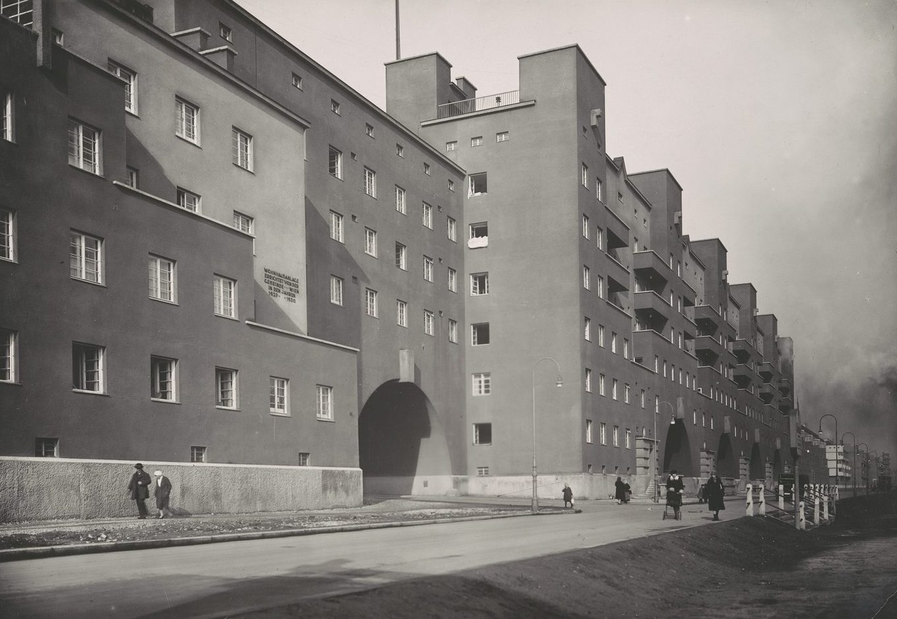

A single block about a kilometre long in Döbling, built by the city to designs by Karl Ehn, a pupil of Otto Wagner. Only 23 percent of the 150,000 square metre site was built on; the rest is courtyards and gardens.

Opened 12 October 1930.

The plaque on the facade, visible in the photograph, reads “Wohnhausanlage errichtet von der Gemeinde Wien in den Jahren 19__–1930” (the first year is not legible in this print). It gives 1930, the year the block opened; the last sections were finished in 1933.

The sources disagree: the same article gives 1,382 flats for about 5,000 residents, and a breakdown by flat type that adds up to 1,043.

It stands in the 19th district, Döbling, at Heiligenstädter Straße 82–92.

:::gallery rows

*Karl-Marx-Hof in Döbling, Heiligenstädter Straße 82–92: a view into one of the passageways through the block. Martin Gerlach jun., around 1930. Wien Museum, inv. 59241/1125, CC0.*

*Karl-Marx-Hof at the corner of Heiligenstädter Straße, Boschstraße and Halteraugasse. Photographer unknown, around 1930. Wien Museum, inv. 57962/424, CC0.*
:::

## Inside the block

- Two kindergartens and a maternity advice centre
- A youth home and a library
- An outpatient clinic, a dental clinic and a pharmacy
- A post office, shops and a central laundry

:::gallery rows

*Karl-Marx-Hof: view of the kindergarten in the inner courtyard. Martin Gerlach jun., around 1930. Wien Museum, inv. 59161/1790, CC0.*

*The kindergarten of the Karl-Marx-Hof, Heiligenstädter Straße 82–92. Martin Gerlach jun., around 1930. Wien Museum, inv. 93083/111, CC0.*
:::

## Afterwards

- February 1934: members of the Republican Defence League held the block until the army shelled it
- 1934–1953: renamed twice; the original name returned in 1953
- 1980s: comprehensive renovation

## Sources

- [Karl-Marx-Hof](https://de.wikipedia.org/wiki/Karl-Marx-Hof), Wikipedia (de), checked 14 October 2026
- [Karl-Marx-Hof, facade towards Heiligenstadt station, Martin Gerlach jun., around 1930, inv. 59241/1126](https://sammlung.wienmuseum.at/en/object/133336-19-heiligenstaedter-strasse-82-92-karl-marx-hof-fassade-zum-bahnhof-heiligenstadt/), Wien Museum Online Sammlung, CC0, checked 14 October 2026
