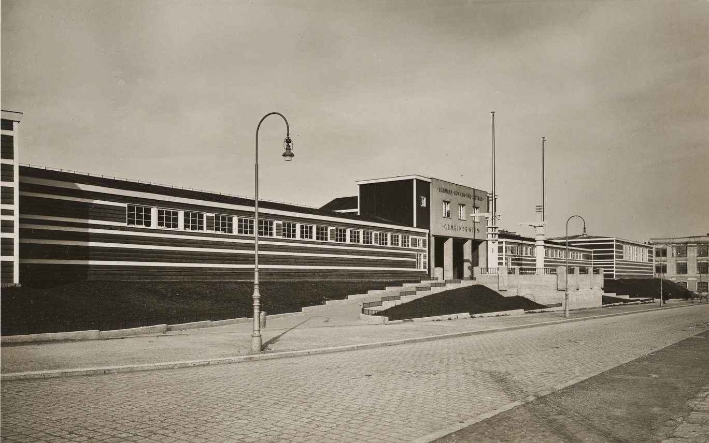

Ein Sommerbad für Schwimmen, Luft und Sonne in Ottakring mit einem 100-Meter-Becken, entworfen von Erich Leischner vom städtischen Bauamt.

Eröffnet am 20. Mai 1928.

## Quellen

- [Kongressbad](https://www.geschichtewiki.wien.gv.at/Kongressbad), Wien Geschichte Wiki, geprüft am 14. Oktober 2026
